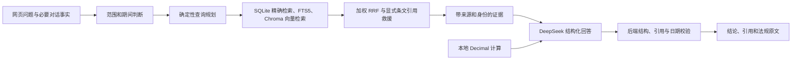

# 增值税政策咨询 RAG

一个面向中国境内货物交易政策咨询的 AI 辅助开发项目。使用者在网页中连续提问，后端从经过核验的本地法规知识库检索依据，再由 DeepSeek 按结构化格式组织回答；条款引用由服务端校验，金额由本地 `Decimal` 计算。

本项目适合作为财税业务理解、RAG 工程和 AI 协作交付的补充作品。它不是 RPA 流程自动化案例，也不替代税务专业人员的判断。

## 项目范围

- 一般纳税人境内销售货物的一般计税基础咨询，包括视同应税交易、计税依据、纳税义务时间，以及与本案相关的发票和进项抵扣问题。
- 小规模纳税人境内销售货物的基础咨询，包括法定征收率、适用期间优惠、起征点和相关开票条件。
- 多轮问答中的用户事实承接、决定性条件追问、法规原文查看，以及单笔和期间税额的确定性计算。

不覆盖进口、出口与跨境业务，也不提供其他税种的完整咨询、行业专项优惠全流程、申报代理或自动办税。本地活动知识库和政策适用期间可能变化，回答应结合页面展示的来源与期间核对。

## 使用流程

1. 打开本机网页并确认云端传输告知。
2. 输入政策问题，按需补充纳税人身份、交易用途、价款、期间等会影响判断的事实。
3. 查看首条结论及其引用，展开本轮法规原文核对来源、条款和适用期间。金额问题使用独立计算表单核对输入、公式与结果。

演示入口为 `http://127.0.0.1:5055`，仅在本机服务运行时可访问。当前没有托管的公网演示站点。

## RAG 与计算链路



查询规划对受控法规简称与条号做确定性规范化，并为 FTS 添加有限口语扩展词，不调用额外模型重写问题。检索包含 SQLite 精确通道、FTS5 全文通道和基于 Ollama `bge-m3` 的 Chroma 向量通道，按配置权重进行 RRF 融合。后续救援只检查首位候选显式引用的同一法规条文，不是通用语义重排。

DeepSeek 接收当前问题、必要对话事实、候选法规证据和本咨询最新的本地计算结果。模型负责按证据组织语言，不负责选择税率或计算金额。服务端校验结构化字段和引用证据身份，网页提供连续咨询、重试、引用跳转与原文回查。

## 技术组成

- Python 3.12、Flask、Jinja、原生 JavaScript
- SQLite 精确/全文检索与运行时记录
- Chroma 向量检索、Ollama `bge-m3`
- DeepSeek 结构化回答
- Python `Decimal`、`ROUND_HALF_UP`
- `unittest` 自动化回归

更详细的数据流、边界和复现说明见 [架构与复现说明](docs/架构与复现说明.md)。

## 本地配置与启动

运行需要完整项目环境中的本地 SQLite 知识库与对应 Chroma 索引、Ollama 服务和 `bge-m3:latest`，以及通过本机环境提供的 DeepSeek API Key。为避免分发法规原件、知识库内容、运行数据库和用户记录，展示仓库不包含这些运行数据。**仅克隆此仓库不能直接启动可检索的咨询服务。**

在已经配置本地知识库的 Windows 环境中：

```powershell
py -3.12 -m venv .venv
.\.venv\Scripts\python.exe -m pip install -r requirements-p2b.lock.txt
$env:DEEPSEEK_API_KEY = '<在本机安全配置的 API Key>'
.\scripts\start_web.ps1
```

浏览器打开 `http://127.0.0.1:5055`。停止服务：

```powershell
.\scripts\stop_web.ps1
```

密钥只应通过本机环境变量或密钥管理器提供。`.env.example` 只列变量名，当前程序不会自动读取 `.env` 文件。确认告知前不会向 DeepSeek 发送咨询内容；确认后，当前问题、必要对话历史、检索证据与计算结果会按告知内容传输。请勿输入真实个人或客户敏感信息。

展示仓库有意省略了本地活动知识库和受保护资料。因此网页端到端检索只能在具备这些本地依赖的完整项目环境中复现。自动化测试命令与依赖于本地资料的测试边界见 [复现说明](docs/架构与复现说明.md)。

## 阶段评估

当前完整评估候选为 `vat-web-concise-final-v6.14`，模型配置标识 `deepseek-flash`。固定题集覆盖 40 个场景、42 轮问答和 4 次本地计算，完成 39 次模型请求。核心结论及必要条件为 40/40 通过，全维度为 29/40 通过，引用支持为 31/33 通过，工程回归为 138 项通过。其余场景仍有表达或条件改进项。

评估来自参与过提示词调试的受控题集，由主 Agent 逐题审查，不是独立留出评估。尚无独立税务专家盲审。因此这些数字不代表行业准确率、专家认证或生产效果。具体分母、格式恢复、引用适用范围和审查限制见 [评估摘要](docs/评估摘要.md)。完整题集、逐题原文和内部运行工件不随仓库分发。

## 目录

```text
src/tax_rag/       Web、对话、检索、证据、计算和存储实现
config/            当前 Web 流程所需的提示词及非敏感配置
scripts/           本机网页启停脚本
tests/              自动化回归与模拟数据
docs/              架构、复现、评估口径与纳入清单
```

`data/`、`artifacts/` 和完整评测集不在展示仓库中。

## AI 协作与贡献口径

项目采用 AI 辅助开发。法规资料筛选核对、咨询流程设计与使用验收包含用户贡献。用户个人的代码贡献范围和比例尚未核实，简历表述应由本人确认后再具体化。
