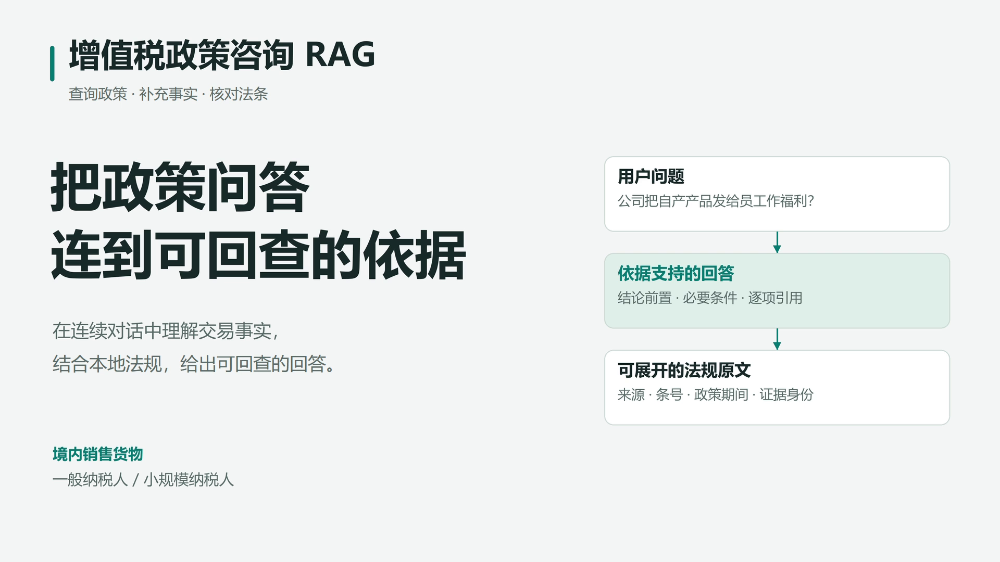

# 增值税政策咨询 RAG · 项目介绍视频

**[▶ 在线播放](https://gx221015cf.github.io/vat-rag-agent-showcase/showcase/)** · [下载 MP4](https://gx221015cf.github.io/vat-rag-agent-showcase/showcase/demo.mp4) · [项目说明](../../README.md)

## 成片

本版采用已经观看确认的扩大取景与双行片尾修订，2026年11月16日从 `VatRagIntroV1` 导出。70.000秒、2100帧、1920×1080、30fps、H.264/yuv420p、BT.709、静音，MP4元信息前置以便网页加载。准确字节数与SHA-256见[媒体清单](media-manifest.json)。封面取自成片1秒处。

## 镜头内容

| 时间 | 内容 |
|---|---|
| 0—4秒 | 项目名称、用途与咨询路径 |
| 4—20秒 | 自产产品用于员工福利的真实提问、结论、引用与增值税法第五条原文 |
| 20—42秒 | 外购追问、员工未付款事实补充及工资扣款条件核对 |
| 42—57秒 | 事实承接、范围期间、确定性查询规划、三路检索、加权RRF、DeepSeek与引用校验 |
| 57—66秒 | v6.14阶段结果及受控评审口径 |
| 66—70秒 | 项目收束、AI辅助开发与Remotion制作说明 |

真实咨询镜头保持原有事件顺序，输入和生成等待已剪短，回答与原文末帧延长供阅读。外购分支保留工资扣款这一未确认条件。技术画面依据当前源码与配置绘制，阶段结果对应2026年11月15日v6.14固定40场景评估。

## 媒体与部署

视频由真实网页录屏、工程示意和可编辑字幕组成，使用 Remotion 制作。源录屏、制作工程、派生帧、完整评测和内部验证记录留在本地项目。

GitHub Pages仅部署三个文件，保留 `showcase/` 路径。

- `showcase/index.html`
- `showcase/cover.png`
- `showcase/demo.mp4`

播放器使用原生 `controls`、`playsinline` 与 `preload="metadata"`，提供独立下载入口。评估的分母、审查方式和剩余项见[评估摘要](../评估摘要.md)。
