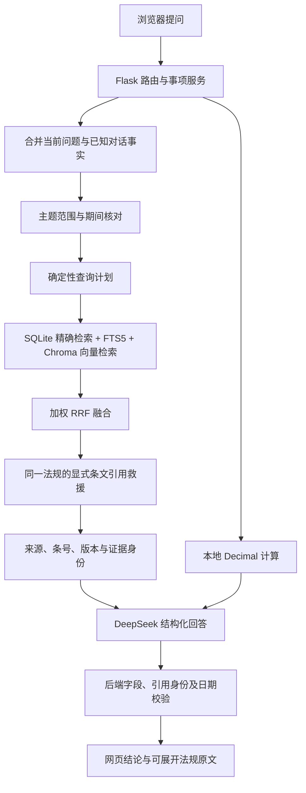

# 架构与复现说明

## 请求链路



## 关键边界

- `domain/conversation.py` 从当前问题和同一咨询中的用户事实形成回答任务与必要上下文，使用确定性规则，不调用额外的查询改写模型。
- `domain/scope_router.py` 和 `config/scope_topics_v2.json` 执行当前范围判断。范围和交易身份是不同概念，模型上下文不把服务范围当成用户事实。
- `retrieval/query_planner.py` 对已配置的法规名称、简称和条号做确定性规范化，并仅对 FTS 添加有限口语扩展词。向量通道仍使用原问题。
- `retrieval/hybrid.py` 汇集 SQLite 精确、FTS5 和 Chroma 向量候选，按配置权重做 Reciprocal Rank Fusion。后续策略救援第一候选显式引用的同一法规条文。
- `services/matter_service.py` 固定编排检索、上下文、模型和计算结果。DeepSeek 只基于本轮证据生成结构化中文回答。
- `services/deepseek_service.py` 读取 `DEEPSEEK_API_KEY`，校验 JSON 结构、引用身份和证据记录的生效日期声明。模型不负责确定计算金额。
- `domain/calculation.py` 使用 `Decimal` 和人民币分位 `ROUND_HALF_UP`。网页提供单笔含税/不含税换算和期间税额汇总。
- `web/routes.py` 提供会话告知、逐轮提问与重试、引用原文回查、计算和健康检查。页面仅绑定回环地址 `127.0.0.1`。

## 本机运行

要求 Windows、Python 3.12、Ollama 服务及 `bge-m3:latest`，并配置可用的 DeepSeek API Key。完整网页还需要经审核的本地 SQLite 知识库和对应 Chroma 索引。法规材料、SQLite 数据库与 Chroma 向量索引需在本机单独配置。

在完整且已配置本地知识库的项目环境中，可运行：

```powershell
py -3.12 -m venv .venv
.\.venv\Scripts\python.exe -m pip install -r requirements-p2b.lock.txt
$env:DEEPSEEK_API_KEY = Read-Host 'Enter the DeepSeek API key'
.\scripts\start_web.ps1
```

访问 `http://127.0.0.1:5055`。停止服务使用：

```powershell
.\scripts\stop_web.ps1
```

`.env.example` 只列出所需变量名。当前应用和启动脚本不会自动读取 `.env` 文件。不要把密钥写入源码、提交记录或聊天输入。

本地自动化测试可在安装依赖后运行：

```powershell
$env:PYTHONPATH = (Join-Path (Get-Location) 'src')
python -m unittest discover -s tests -v
```

部分检索与资料构建集成检查依赖未分发的本地知识库或官方源文件。测试记录和依赖缺口应如实报告。
